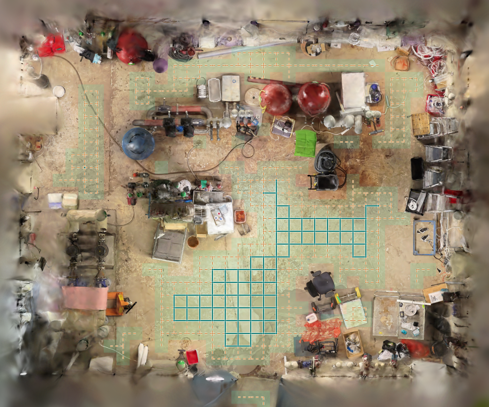

# Valmet Field App

Flutter starter for the Valmet hackathon challenge. See [challenge details](challenges.md).

Team coordination: [development plan](PLAN.md) · [full challenge notes and scoring](challenge-shortlist.md).

## Run the spatial backend and browser viewer

This is the backend-first workflow from the original Valmet brief. It uses the
complete `Equipment Room.ply`, automatic geometric proposals with review,
person-sized walking routes, explicitly synthetic workbook associations and a
local AI evidence report. The iOS viewer and image detectors are independent.

From the repository root, with approved local source files and Flutter/Dart on
PATH:

```sh
python3 -m venv sources/valmet/.venv
source sources/valmet/.venv/bin/activate
python -m pip install -r tools/requirements-spatial.txt
flutter pub get
python tools/spatial_backend.py \
  --scan "sources/valmet/Equipment Room.ply" \
  --workbook "/path/to/Valmet builder workbook.xlsx"
```

Open **http://127.0.0.1:8080**. Existing registered assets are read without
modification. If the packed scene has not been generated, prepare a separate
input folder and pass `--assets build/spatial-input` to the viewer:

```sh
python tools/build_boiler_room.py "/path/to/Equipment Room.ply" --output build/spatial-input
```

The scene starts with a display cutaway above 2.2 m; **Show ceiling and upper
structure** restores the full scan. This affects display only. Gaussian colour
uses the stored base RGB; the original app asset retains its view-dependent
colour coefficients.

Choose a target and start cell, then **Plan route**, **Play**, **Pause** or
**Reset**. **Follow person** follows travel and faces the equipment at arrival.
The person envelope is 0.60 m wide and 1.80 m tall with a 0.05 m overhead margin.
Nearby frames and source conditions update within 2.5 m. Arrival opens a cited
inspection report; any blocked/disconnected start produces an explicit no-route
result. The model-space envelope is not an independently calibrated physical
safety assessment.

For local explanations, run Ollama in another terminal with the already cached
`qwen3.5:9b` model:

```sh
OLLAMA_NO_CLOUD=1 ollama serve
```

The backend calls only loopback Ollama. An absent, timed-out or invalid model
response leaves the deterministic evidence report usable. Explanations retain
synthetic disclosure, unconfirmed-cause wording, source citations and the supplied
next verification. Numeric trends are calculated from first/last 12-hour medians;
they are not live telemetry or a confirmed fault diagnosis.

In **Extraction review**, choose a proposal, inspect it from two directions at
least 30 degrees apart and record each view. Accept, reject, rename, merge, split
or refine its bounds. Geometric proposals are not automatically named or counted
as equipment. Review records identify the reviewer; the checked local display
stand addition was reviewed by an agent from two full Gaussian renders.

Generated data stays in ignored `build/spatial/`: the person `site.json`, unchanged
legacy workbook bundle, association and diagnostic sidecars, and
`catalog/review.json` plus splat memberships. Keep that review file with approved
private assets to replay decisions on another machine. A fresh output directory
starts with the baseline 33 objects and unaccepted proposals.

`lib/spatial_data.dart` loads the optional sidecars through a tested adapter.
Without them, original tag/report behaviour is preserved. No iOS or Core ML change
is required to generate these exports; Mac can adopt them separately. Use
`--prepare-only` to export data without starting a browser server.

```sh
python -m unittest discover -s tools -p 'test_*.py'
flutter test
flutter analyze
```

Full Gaussian evidence rendering additionally uses `tools/requirements-render.txt`.
Private scan, workbook, review evidence and generated exports are not published.

## Linux backend setup and product handoff

Linux owns scene/navigation and workbook/diagnostics on `zoltam`. Mac owns iOS,
Core ML and simulator integration directly on `main`. Keep stable object IDs,
registered coordinates, workbook schema and route payload compatible across both.
The current Linux environment uses Python 3.14.7, Flutter 3.47.9 and Dart 3.13.7.

Run the asset preparation commands below from this repository directory using
approved local scan and workbook copies. NumPy builds the scene, openpyxl imports
the workbook, and Pillow is needed for the complete Python test suite:

```sh
python3 -m venv sources/valmet/.venv
source sources/valmet/.venv/bin/activate
python3 -m pip install numpy Pillow -r tools/requirements-data.txt
```

After generating the assets and running `flutter pub get`, verify the backend:

```sh
python3 -m unittest discover -s tools -p 'test_*.py'
flutter analyze
flutter test
mkdir -p build
dart run tools/audit_service_routes.dart > build/service-route-audit.json
dart run tools/verify_asset_data.dart > build/asset-data-audit.json
```

The route audit checks shortest paths and continuous clearance for all walkable
starts to each of six service targets. The workbook audit checks eight compatible
service/nearby assignments, exact tags, row citations and deterministic offline
reports. Audit output includes private evidence and stays local in ignored
`build/`. Reproducible source/generated hashes and evidence limits are in the
[technical note](docs/TECHNICAL-NOTE.md).

New native runtime verification is simulator-only and belongs to Mac. Historical
physical iPhone commands and measurements below document existing functionality.
They are not Linux verification. On revision `87cbaa2`, Mac recorded one simulator
fixed-view run confirming all 20 enabled supplemental IDs and an empty negative
view. R3's separate simulator inference-context gate failed. Fixed views do not
measure precision/recall or establish reliable recognition of all 33 objects.
The rear red vessel and two orange actuators remain below the release gate.
Repeated six-target and difficult-approach checks must match the combined revision.

## Run on iOS

Use macOS with Xcode, Python 3 and Flutter with Dart 3.12.2 or later
(tested with Flutter 3.44.3). For the full demo, use an ARKit-capable iPhone
and obtain approved copies of the replacement `Equipment Room.ply` and the
Valmet synthetic builder workbook (`.xlsx`). The replacement scan has
1,676,481 vertices. The earlier `Industrial Boiler Room (1).ply` uses a
different scene registration.

From the repository root, prepare the local assets before building:

```sh
python3 -m venv sources/valmet/.venv
source sources/valmet/.venv/bin/activate
python3 -m pip install numpy Pillow -r tools/requirements-data.txt
python3 tools/build_boiler_room.py "/path/to/Equipment Room.ply"
python3 tools/import_asset_data.py "/path/to/Valmet_SinceAI_2026_Synthetic_Industrial_Metaverse_Builder_Pack (1) (2) (1).xlsx" \
  --site assets/valmet/site.json --include-nearby
flutter pub get
```

Connect the iPhone, open `ios/Runner.xcworkspace` in Xcode, and select
your team and a unique bundle identifier under Runner → Signing & Capabilities.
Select the connected iPhone as the run destination and run the Runner scheme.
The simulator can preview the Flutter settings. The AR walkthrough requires
the physical iPhone. The repository already includes the Core ML detector.

## Walk inside the 3D model

The main screen shows the planned route distance for the selected target and
camera clearance. Open the maintenance report after reaching the target in
the 3D viewer.

Enable **Forward and backward controls** under **Settings** to move with the two on-screen buttons or ↑/↓. Turn by rotating the phone. This mode still uses ARKit to track orientation.

Choose **3D frame rate** under **Settings** before opening the viewer: 15, 30
(default), or 60 FPS. This is a target; the device may render more slowly.

The 3D viewer's top-right map shows the room PNG, your blue position/heading,
the active mint route, and the gold destination. Tap it to enlarge; **Done**
returns to the viewer. Both map sizes follow obstacle-driven replanning.
Position appears after alignment and disappears if tracking is unavailable.
The bundled PNG is calibrated to the reviewed Equipment Room scan; a vector
map is used if the scan differs or the image cannot be loaded.

On an ARKit-capable iPhone, select a service target and tap **Walk inside the 3D model**. Stand at the physical spot that should correspond to the virtual start, hold the phone upright and face the direction of the first route segment. The app assumes an initial phone height of 1.50 metres and uses the phone’s angle for the view. Tap **Set start and direction**. ARKit drives the virtual camera with the phone's rotation and translation, with one physical metre equal to one model metre. **Show camera** switches back to the live view while tracking continues. Use **Reset alignment** to choose a new physical start.

The importer requires the complete Equipment Room scan. It registers the scan against the reviewed equipment frame and renders all 1,676,481 splats with their anisotropic covariance, opacity, and degree-3 view-dependent color. The navigation grid comes from observed floor and obstacle geometry. A neutral backing surface fills missing floor pixels and leaves walkability unchanged. Distances assume the reviewed scene uses metres. Keep the organizer's scan and derived assets local unless public redistribution is authorized.

The iPhone detector samples the full rendered image locally at up to 8 frames per second. It skips frames while inference is busy. It returns image-space boxes for the catalog objects, without reading coordinates or camera images as recognition input. Routing and arrival use the separately mapped walkable approach.

### Additional-object detector

The app includes an RF-DETR Nano FP16 Core ML supplement at
`ios/Runner/RFDETRSupplemental.mlpackage`, with its Apache 2.0 notice at
`ios/Runner/RFDETR-LICENSE.txt`. Xcode compiles the source package when building.
Normal launches run it alongside the existing R3 detector. Use the launch
argument `--disable-rfdetr-supplemental` for a baseline-only check.
The supplement has an independent bounded inference queue and two-frame
confirmation history. R3 handles the middle blue actuator until a current
RF-DETR result arrives. It resumes after a stop or a 0.40 s result gap. Each
ID has one visible source. Capture-time 3D association follows image inference.

The first epoch-16 release qualified 14 additional instances on both validation
and test at per-instance precision ≥95% and recall ≥70%, after pose association
and deduplication. The separate image-only policy qualified ten additional
instances. These are different evaluated policies. Across all 33 candidates,
the pose-associated test produced 2,243 true positives, 81 false positives and
392 misses. Three difficult instances still have low recall, particularly the
two orange actuators and the rear red vessel. Validation-only threshold changes
qualified four more instances on the archived 292-view test. Floor carton,
black shelf cart and yellow-wheel hand truck also passed on new views. Short
step ladder qualified on the archive, with 62 positive examples. The new-view
set had no positive examples of that ladder. The rolling chair also qualified.
The enabled catalog contains 30 IDs, comprising the original 11 IDs and 19
additions.

The iPhone check found all 14 additional IDs in their respective fixed views
and showed no supplemental overlay in the negative view. Both baseline and
combined runs missed the same wall-pump approach view. All six service journeys
passed recognition, arrival and workbook-evidence checks with the supplement.
A separate 2.0 m alternate P-005 journey also passed.
With the four new thresholds, iPhone verification confirmed each newly
enabled object, the empty negative view and the alternate P-005 journey.
The middle actuator handoff and R3-only fallback both passed on iPhone.
On the original 69-view walking test, the handoff model found the middle
actuator in 12 of 14 positive views at score 0.78. R3 found it in two.

After a 12.49 s cold-model warmup, the 90-second combined benchmark produced
719 supplemental samples at 7.99 Hz, with p95 inference of 27 ms and one stale
sample. Rendering averaged 27.21 FPS versus 28.88 for R3 alone. R3 p95 inference
was 28 versus 6 ms, and overlay p95 age was 129 versus 110 ms. Both runs were
thermally constrained. This records the shared-resource cost on the tested
iPhone 15, iOS 26.5. The extra IDs become available after background model load.

Optional local data conversion, training/resume and typed Core ML export are
documented in [the detector tooling guide](tools/README-detector.md).

To retrain the detector, use the prepared scan and Python environment from
the setup above:

```sh
python3 -m pip install Pillow
swiftc -O tools/build_pump_references.swift -o /tmp/valmet-pump-references
/tmp/valmet-pump-references --detection-dataset-hq
python3 tools/prepare_detection_views.py build/valmet-detection-hq
swiftc -O tools/train_equipment_detector.swift -o /tmp/valmet-train-equipment-monitored
/tmp/valmet-train-equipment-monitored 600 --model="$PWD/build/valmet-detection-hq/candidate.mlmodel" > /tmp/valmet-detector-hq-training.log 2>&1
```

In another terminal, monitor without altering the worker:

```sh
python3 tools/monitor_equipment_training.py --watch --log /tmp/valmet-detector-hq-training.log \
  --model build/valmet-detection-hq/candidate.mlmodel --trainer /tmp/valmet-train-equipment-monitored
```

Train and select on validation, then evaluate the chosen export with `--evaluate-only --split=test --model=<candidate>`. Append the test output to the run log so the monitor can show the completed result. Each `VALMET_EVAL` row reports counts for one instance. Training and checkpoint export default to `candidate.mlmodel` inside the dataset; evaluation alone defaults to the bundled detector. For intermediate checkpoints, copy the training session directory before using `--checkpoint-dir=<copy> --checkpoint-iteration=<step> --model=<separate-output>` on validation. The monitor can verify the evaluated export with `--expected-sha256 <digest>`. The repository includes the evaluated Core ML detector at `assets/valmet/equipment-detector.mlmodel`, which the iPhone app bundles automatically. The scan, renders and training checkpoints stay local.

The generated scene JSON also contains reviewed equipment volumes and stable `objectId` values for the workbook and proximity features. See [the scene handoff](PLAN.md#scene-and-equipment-handoff) for coverage and coordinate assumptions.

For an installed development build on a connected and unlocked iPhone, repeat the renderer-to-model checks:

```sh
xcrun devicectl device process launch --device <device> --terminate-existing --console <bundle-id> -- --verify-rendered-vision
xcrun devicectl device process launch --device <device> --terminate-existing --console <bundle-id> -- --benchmark-rendered-vision
```

The verification prints image-space boxes for several rendered views. To check
specific views with the workbook loaded, pass a JSON array after
`--verify-rendered-vision`. Each entry has an `id`, an `eye` and `look` point in
registered scene metres, and optional `expectedIDs` and `absentIDs` lists of
scene object IDs. Each pose logs raw, 3D-matched and confirmed IDs separately.
The expected and absent lists are checked against confirmed overlays.

The 15-second benchmark reports GPU frames, frame rate, inference latency and
frame-to-overlay latency. `inference_samples` counts completed predictions,
`overlay_updates` counts predictions accepted by the frame freshness check,
and `confirmed_frames` counts accepted predictions that show a box. Report
all three counts and the iPhone/iOS versions when investigating missing
boxes. The run is invalidated if the app loses foreground focus.
Append `--benchmark-seconds=90` after `--benchmark-rendered-vision` for a
sustained check with cumulative counters every 15 seconds. Compare adjacent
checkpoints to see whether inference, accepted predictions or visible boxes
stop increasing. The duration is bounded to 15–180 seconds.

To check target confirmation and arrival on the route from the Dart planner, run
the scripted service journey on the connected phone:

```sh
xcrun devicectl device process launch --device <device> --terminate-existing --console <bundle-id> -- \
  --verify-service-journey "$(dart tools/verify_service_route.dart)"
```

Pass a scene object ID to `dart tools/verify_service_route.dart` to test
another service target. Append two floor-cell coordinates, `start-x start-z`,
after the ID to test an alternate start. The app's **Service target** selector offers the five
pumps and inline valve. Their routes are available at the default 0.10 m
virtual-camera radius.

The log records distance, target confirmation, arrival, workbook evidence and
visible mapped frames. The journey passes only when all are present. The
script moves the virtual camera. Verify physical AR walking separately.

To rehearse the route and workbook UI on a booted simulator, launch the
installed build with the same arguments:

```sh
xcrun simctl launch --terminate-running-process booted <bundle-id> \
  --verify-service-journey "$(dart tools/verify_service_route.dart)"
```

The simulator renders the journey without AR tracking. R3 reports an
inference-context error on the tested iOS 26.5 simulator. To exercise the
full gate with RF-DETR on rendered simulator frames, append
`--simulator-rf16-journey` and use an optimized Swift build
(`SWIFT_OPTIMIZATION_LEVEL=-O` for Debug). This exercises the selected
target with its existing score threshold. The regular app retains its
R3 and RF-DETR detector configuration.

## Navigation and inspection evidence (member 2)

The Flutter screen plans four-neighbour routes over measured floor support on
10 cm cells. Floor observations retain opacity down to 1%. Each floor cell needs
three observations, or two direct observations plus at least 14 across its 3×3
neighbourhood. A sparse cell can also use two measured Gaussian 2σ floor
footprints covering its centre, with the same nearby evidence requirement and a
12 cm maximum reach. This uses the actual scan surface rather than filling
unknown gaps. Strong obstacle observations between
0.17 and 1.55 m block movement, matching the virtual camera's 1.50 m height plus
5 cm margin; this is not standing-person clearance. Real low obstacles stay blocked.
Radius clearance runs in the planner and the native viewer uses the same mask.
Manual movement checks substeps no longer than half a cell to prevent skipping
obstacles. The registered renderer/detector frame and existing equipment bounds remain
unchanged; the reviewed pump approach moves only 3.5 cm to a finer cell centre.

The repository includes the generated navigation map at `assets/valmet/site.json`
and its PNG illustration at `docs/images/equipment-room-walking-paths.png`.
Regenerating the scan assets also refreshes the navigation JSON.

The current Equipment Room build contains 3,213 observed floor cells. With the
default 0.10 m radius, 2,130 cells pass clearance and 2,106 connect to the pump:
21.06 m², compared with 11.19 m² previously. Seven reviewed room regions,
including the upper-middle aisle, are reachable. The remaining 24 clearance-valid
cells form small separate patches; they are not shown as connected walking paths.
The upper aisle was checked in actual Gaussian renders from both directions.
Run `flutter test test/scan_navigation_test.dart` after generating local assets to
check these connections, low obstacles, equipment bounds and preview arrival.



Teal lines show the connected 0.10 m virtual-camera walking network; orange shows
the 3.10 m pump route. The picture uses the same registered coordinates,
equipment catalogue and full-scan asset as the app. The overhead illustration
cuts geometry above 1.35 m to reveal the floor.

The **Virtual camera radius** selector checks obstacles, unknown floor and map
boundaries. If a target has no route, free exploration remains available.
A blocked starting point is reported explicitly.
Physical AR movement cannot be constrained; leaving the mask displays a warning.

On the iPhone, set the start and direction, then follow the mint floor arrows along the curved line to the
gold service marker in the 3D viewer. Walk with the phone or enable **Forward and backward controls** to
move with arrows and turn by rotating the phone. **Show camera** switches to
the camera feed, and **Reset alignment** lets you align again. Arrival uses
horizontal distance to the service point, separately from target recognition.
The viewer frames nearby catalog objects within 2.5 m and labels visible frames
with their synthetic condition. The panel lists the three closest objects.
The scene includes 33 reviewed frames. The catalog flags 11 baseline R3 IDs;
the supplemental contract brings the integrated enabled total to 30 distinct IDs.
The 20 approved supplemental IDs include one baseline handoff, so the union is 30.
Reviewed frames and enabled IDs do not prove reliable image recognition.
Workbook metadata appears only for compatible mapped scene objects; recognition
boxes and geometric proximity frames are separate signals. The supplied data maps five pumps and one inline valve.
A box requires two consecutive detections that agree with the mapped 3D bounds.
At the service point, tap **Open maintenance report** below the arrival message.

To demonstrate a moving obstacle, enable **Movable demo crate** before opening
the viewer. Align, tap **Place demo crate**, and aim down at its tag. After the
tag is seen in two frames, the planner applies the observed footprint to the
walkable map and redraws a blocked route. **Move demo crate** repeats the check.
If the new footprint covers your position, step back onto a walkable cell to
recalculate the route. With button controls, use **Reset alignment** to return
to the start and replan.
The demo uses a tagged simulated crate with a known size and height.

To verify placement and mask replacement on iPhone:

```sh
xcrun devicectl device process launch --device <device> --terminate-existing --console <bundle-id> -- \
  --verify-obstacle-reroute "$(dart tools/verify_service_route.dart)"
```


The importer writes ignored `assets/valmet/asset-data.json`, retaining original
values, worksheet row references and a workbook SHA-256. It imports the included
3-day telemetry sample, not the unavailable full telemetry CSV. Original inputs
can be kept in ignored `sources/valmet/`. Keep source and generated data local.

By default it sorts service-object IDs and associates them with compatible
workbook classes by increasing health score, breaking ties by asset ID. The
nearby option considers the remaining scene objects without changing service
targets. Pumps map to `PROCESS_PUMP`. The inline valve uses `CONTROL_VALVE` as
its synthetic valve-family mapping. The app shows the exact workbook tag
alongside the scene name. The two reviewed orange actuators show their own
names with synthetic parent-valve records. Nearby assignments prefer the
healthiest remaining compatible records. These workbook identities are synthetic.
Override it with `--mapping /path/to/mapping.json`, whose JSON object maps scene
`object_id` to workbook `asset_id`. Explicit `objectId` or `object_id` values are preferred;
older objects use `grid:x:z:width:depth`. Regenerate/review the mapping when
fallback geometry IDs change. Unknown or duplicate IDs are rejected.
Explicit overrides must match the same equipment classes as automatic mappings.

The iPhone **Inspection evidence** panel shows supplied current state, the
latest telemetry and the two ends of the included sample period, recent events
and work orders, context documents, matching historical hypotheses and their
evidence workflow, and data-quality flags. If the workbook has an open event
matching the asset's current issue code, the report includes the newest such
event alongside the recent evidence. Workbook evidence keeps its row references.
The snapshot date and supplied model confidence stay visible. This is a local,
deterministic evidence-retrieval baseline; it does not call a generative AI model
or establish a confirmed cause. Missing records remain explicit. Mac owns vision model integration and native
verification. The existing tagged-crate experiment stays separate; no new
unexpected-obstacle avoidance is included.

Checks:

```sh
flutter analyze
flutter test
python3 -m unittest discover -s tools -p 'test_*.py'
```


## Desktop render checks

For optional desktop inspection with OpenGL/EGL:

```sh
python3 -m pip install -r tools/requirements-render.txt
python3 tools/render_scene.py --top-down --cut-height 1.35 \
  --plan-bounds 1.7163 1.6062 11.2871 9.5537 \
  --width 2400 --height 2000 --output /path/to/equipment-room-plan.png
```

The helper reads the current `boiler-room-sh.splats` format, including degree-3
view-dependent colour, covariance and opacity. It renders depth-sorted Gaussian
ellipses rather than plotting point centres. Use `--camera X Y Z --target X Y Z`
for perspective inspection. Bounds only crop the illustration; they do not alter
the scan or navigation map. Desktop captures do not replace iPhone checks.
