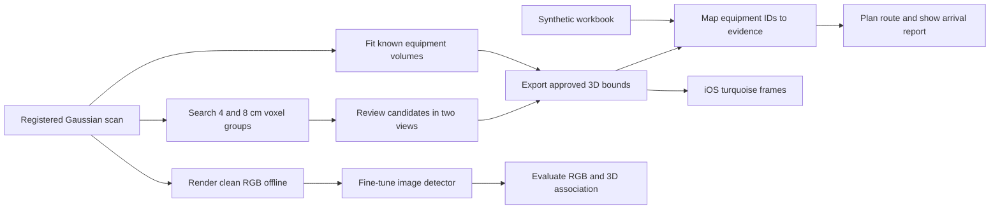

# ServicePath · AI development report

This report covers offline equipment extraction from the replacement Equipment Room scan, evaluation of image recognition and the handoff to the iOS service simulation. The release baseline was main revision `faeac88`. Results below distinguish the local integration, the shipped detector pair and experimental research.

## From Gaussian splats to a service target

| Local geometry result | Count | Basis |
| --- | ---: | --- |
| Registered Gaussian splats | 1,676,481 | Complete replacement scan |
| Fitted catalog volumes | 33 | Existing registered seeds, each with 279–13,741 supporting splats |
| Unseeded voxel proposals | 38 | Search outside the registered seed memberships |
| Newly accepted object | 1 | Freestanding display stand, 2,104 supporting splats, two reviewed Gaussian views |
| Proposals pending review | 37 | Excluded from the app catalog |
| Objects in the exported map | 34 | 33 fitted assets and the display stand |

The offline fitter selects finite Gaussian centres in each registered seed at opacity ≥0.12. With at least 50 samples, it takes the 1st and 99th percentiles on each axis and adds 1 cm of padding. The output stores `extractionBounds`, source hash, fitting method and membership reference. The initial seed supplies the object's identity and search volume. The calculated bounds supply the turquoise frame. The previous operational bounds still govern routing and detector registration.

The unseeded search excludes prior memberships, floor-level points and dominant outer wall slabs. It groups 26-connected occupied voxels at 4 and 8 cm, rejects small or implausibly large components and suppresses duplicate groups by testing overlap against the smaller membership. A reviewer names accepted components from the rendered room. The display stand remains geometry-only because the workbook supplies no defensible identity for it.

Re-running the same inputs and review state reproduced the site, workbook bundle, associations, review and all 71 splat memberships. All six routes also reproduced. [Spatial backend](../tools/spatial_backend.py) · [Catalog fitting and review](../tools/spatial_catalog.py)

## Recognition baseline

The baseline combines the Create ML R3 detector for nine IDs and RF-DETR Nano FP16 for 21 IDs. Three of the original 33 are outside the shipped recognition policy. The new stand has no trained image class. The local route verification below used the temporarily vision-disabled app build. Offline evaluation and simulator diagnostic flags used the clean rendered RGB pipeline.

The 48-view replay used the current Core ML artifacts, the replacement scan and a frozen annotation set reviewed by agents. The raw policy scores thresholded model boxes. The pose policy additionally applies capture-time registration, strongest-box selection and the existing chair conflict rule. The archive does not establish transfer to a different room.

| Evaluation | TP | FP | FN | Precision | Recall | IDs meeting gate |
| --- | ---: | ---: | ---: | ---: | ---: | ---: |
| 48 views, RGB only | 333 | 66 | 123 | 83.5% | 73.0% | 6 |
| 48 views, pose-associated | 331 | 20 | 125 | 94.3% | 72.6% | 10 |
| 69 archived walking viewpoints, 11 annotated IDs, RGB only | 204 | 33 | 46 | 86.1% | 81.6% | 3 |

The per-ID gate is precision ≥95%, recall ≥70%, IoU ≥0.50 and at least eight positive instances. Twenty-two IDs had eight or more positives in the 48-view replay. The walking archive labels 11 equipment IDs and had that support for seven. Detections outside those 11 IDs were excluded from its metrics. Its annotations and sampled views differ from the 48-view replay. It measures RGB detections at held-out walking positions, with adjacent-frame behavior measured separately in the simulator.

P-005 passed on the walking archive with 67 true positives, three false positives and two misses (95.7% precision, 97.1% recall). Its 48-view results fell below the gate in both modes. Pose association reduced false positives from five to two while recall fell from 62.5% to 50.0%. These two evaluations support retaining the existing model as a comparison point.

Per-object baseline results

Counts are true positives / false positives / misses. Walking scores cover only the annotated IDs. A gate result requires eight positives as well as the precision and recall thresholds.

| Object | Detector | 48 views RGB | 48 views with pose | Walking RGB | Gate RGB / pose |
| --- | --- | ---: | ---: | ---: | ---: |
| red-circulation-pump | R3 | 5/5/3 | 4/2/4 | 67/3/2 | — / — |
| middle-circulation-pump | R3 | 10/3/3 | 10/1/3 | 38/7/6 | — / — |
| wall-circulation-pump | R3 | 9/5/3 | 9/2/3 | 18/7/11 | — / — |
| far-circulation-pump | R3 | 14/11/8 | 14/3/8 | 13/0/1 | — / — |
| black-circulation-pump | R3 | 8/2/13 | 8/2/13 | 5/0/1 | — / — |
| blue-inline-valve | RF-DETR | 21/0/3 | 21/0/3 | 7/0/0 | Pass / Pass |
| left-control-cabinet | R3 | 15/1/9 | 14/1/10 | 3/0/1 | — / — |
| right-control-cabinet | R3 | 11/8/8 | 11/0/8 | 21/7/7 | — / — |
| left-blue-actuator | R3 | 1/0/23 | 1/0/23 | 1/1/5 | — / — |
| middle-blue-actuator | RF-DETR | 20/0/3 | 20/0/3 | 12/0/2 | Pass / Pass |
| right-blue-actuator | R3 | 8/8/6 | 8/4/6 | 19/8/10 | — / — |
| floor-fan | RF-DETR | 26/6/0 | 26/0/0 | — | — / Pass |
| floor-carton | RF-DETR | 21/0/9 | 21/0/9 | — | Pass / Pass |
| blue-platform-trolley | RF-DETR | 23/3/0 | 23/0/0 | — | — / Pass |
| rolling-chair | RF-DETR | 15/1/6 | 15/0/6 | — | — / Pass |
| white-jerrycan | RF-DETR | 12/1/2 | 12/1/2 | — | — / — |
| black-storage-bin | RF-DETR | 0/0/1 | 0/0/1 | — | — / — |
| rear-leaning-ladder | RF-DETR | 0/0/0 | 0/0/0 | — | — / — |
| short-step-ladder | RF-DETR | 0/0/0 | 0/0/0 | — | — / — |
| tall-step-ladder | RF-DETR | 2/0/1 | 2/0/1 | — | — / — |
| front-leaning-ladder | RF-DETR | 9/0/0 | 9/0/0 | — | Pass / Pass |
| black-shelf-cart | RF-DETR | 11/1/2 | 11/0/2 | — | — / Pass |
| silver-platform-cart | RF-DETR | 28/5/3 | 28/2/3 | — | — / — |
| yellow-wheel-hand-truck | RF-DETR | 17/0/5 | 17/0/5 | — | Pass / Pass |
| red-wheel-hand-truck | RF-DETR | 17/4/1 | 17/1/1 | — | — / — |
| black-hand-truck | RF-DETR | 14/0/1 | 14/0/1 | — | Pass / Pass |
| green-chair | RF-DETR | 3/0/1 | 3/0/1 | — | — / — |
| gray-cleaning-cart | RF-DETR | 3/0/0 | 3/0/0 | — | — / — |
| rear-red-vessel | disabled | 0/0/4 | 0/0/4 | — | — / — |
| doorway-blue-valve | RF-DETR | 6/2/1 | 6/1/1 | — | — / — |
| front-red-vessel | RF-DETR | 4/0/0 | 4/0/0 | — | — / — |
| orange-actuator-a | disabled | 0/0/1 | 0/0/1 | — | — / — |
| orange-actuator-b | disabled | 0/0/3 | 0/0/3 | — | — / — |
| display stand | Untrained | — | — | — | — |

## Offline 3D localization from multiple views

The current local app build uses the project's own 3D fitting algorithm for all 33 equipment identities. RF-DETR supplies the identity, confidence and a 2D detection for each rendered RGB view. Our algorithm uses camera poses and the scan's Gaussian splats to estimate the position and dimensions. The previous 3D boxes were withheld from fitting and used afterward as comparison proxies.

1. **Survey the scan.** Select 24 well-spaced camera positions from the observed floor and render eight directions at each position. This produces 192 initial views without targeting catalog coordinates. Follow-up views use rays or centers from the initial predictions.
2. **Triangulate per identity.** Keep the strongest detection per camera position. Cast a 3D ray through each box center and test ray pairs for a common location. Reject pairs with weak parallax or more than 20 cm between their closest points. Count a ray as supporting the hypothesis when it passes within 19 cm of the candidate center. Prefer more supporting views, then higher confidence and smaller residuals. A strict fit requires at least three above-threshold positions. A corroborated fit requires two above-threshold positions and at least five supporting positions in total.
3. **Vote on observed geometry.** Project nearby Gaussian centers into the supporting camera views. Keep centers that land inside their detection rectangles in at least 70% of the supporting views, with a minimum of three votes. Require at least 50 centers. Compute the axis-aligned bounds from the 1st and 99th percentiles and add 15 mm per face. This suppresses isolated outliers while leaving room for the Gaussian extent.
4. **Recover occluded surfaces when supported.** For the rear red vessel, grow the accepted geometry into a neighboring 3.5 cm voxel component with the same dominant color. The component must share at least 40% of the existing point membership. This recovered the lower part of the vessel and raised its 3D IoU from 0.426 to 0.566.
5. **Validate and export.** Retain each approved box and its scan-point membership under the stable object ID. The export checks the source hash, ordered finite bounds and valid point indices. The app reads `extractionBounds` from the bundled map and projects the turquoise frame for the current camera view. The geometric fit runs only during preparation. Routing geometry and workbook associations retain their existing registration. [Fusion implementation](../tools/spatial_vision_fusion.py) · [Reproduction command](../README.md)

| Final result | Evidence |
| --- | --- |
| 33 of 33 equipment identities localized | 32 strict fits and one corroborated fit |
| 32 of 33 at 3D IoU ≥0.50 | Median 0.659 against the previous reviewed volumes |
| Doorway blue valve | 3D IoU 0.481. The new box projected closer to the annotated valve in all seven separate views. Median projected IoU rose from 0.401 to 0.477. The scan contained 180 blue supporting centers and none in the extra depth covered by the previous box. |
| Final app and animation | Same 33 equipment fits plus one display stand from the separate voxel search. Six simulated routes opened the matching service reports. |

3D IoU is the intersection volume divided by the union volume. The comparison volumes are earlier reviewed boxes. The separate valve check measures the visible projection and scan support, so it does not establish an exact hidden surface. This evaluation covers known equipment identities in this scan. It does not establish accuracy in a different room or for previously unseen equipment classes. The detailed per-object results are in the local export's `vision-audit.json`.

## Offline fine-tuning experiment

The experiment resumes the full RF-DETR Nano epoch-16 checkpoint with its optimizer and scheduler state. It runs one additional epoch on Apple Metal Performance Shaders at a 384 px model input. The fixed training subset contains 384 distinct clean same-scan renders and 3,821 labeled boxes covering the 33 existing classes. Positive support ranges from 39 to 206 boxes per class. Exact RGB hashes were checked against the 259 validation and 292 test views. These benchmarks were used in earlier development, so they measure regression on held-out renders of the same room.

The continuation uses a batch of four, two-step gradient accumulation, seed 33 and an initial head learning rate of 0.00003. The baseline EMA is the checkpoint behind the bundled RF-DETR export. The experiment compares both PyTorch checkpoints on CPU at the same frozen thresholds and IoU ≥0.50. Its scores are separate from the Core ML replay above. Validation guides the adoption decision. The test split remains fixed.

| Split | Model | TP | FP | FN | Precision | Recall | F1 |
| --- | --- | ---: | ---: | ---: | ---: | ---: | ---: |
| Validation, 259 views | Epoch 16 | 1,926 | 94 | 346 | 95.3% | 84.8% | 0.897 |
| Validation, 259 views | Epoch 17 | 1,906 | 99 | 366 | 95.1% | 83.9% | 0.891 |
| Test, 292 views | Epoch 16 | 2,209 | 117 | 426 | 95.0% | 83.8% | 0.891 |
| Test, 292 views | Epoch 17 | 2,213 | 114 | 422 | 95.1% | 84.0% | 0.892 |

P-005 validation changed from 48/2/7 to 47/3/8 (true positives / false positives / misses). Test false positives rose from three to five with the same 58 true positives and two misses. The number of classes passing the per-ID gate fell from 23 to 15 on validation and from 20 to 18 on test.

In a separate 48-view 3D localization comparison, the same ray and splat fitter produced 21 regions for each RF-DETR checkpoint. Epoch 16 had 11 regions at 3D IoU ≥0.50 against the existing boxes. Epoch 17 had 10. P-005 overlap improved from 0.70 to 0.73. This comparison uses existing boxes as a proxy and measures a different stage from image precision and recall.

The candidate failed the validation gate and stayed private. The existing model remains the deployment baseline.

## Runtime handoff and presentation

The app validates source registration before loading the offline extraction map and workbook sidecars. It displays nearby geometry, the yellow service marker and the route. An eligible service target requires an evidence association and a reachable approach. At arrival, the simulation opens the workbook-backed inspection report.

All six routes opened their matching report on the iOS 26.5 simulator. P-001, P-002, P-003 and CV-003 each covered 3.6 m from the exported start. P-004 covered 2.7 m and P-005 covered 2.9 m. The P-005 arrival screenshot verified the service marker and turquoise frames. Two optional RF-DETR diagnostic journeys reached P-005 and opened its report, but their results arrived too late for target confirmation. These runs are separate from the normal vision-disabled route tests.

| Verification | Result |
| --- | --- |
| Python, including local integration fixtures | 54 passed |
| Flutter with the staged export | 36 passed |
| Native iOS XCTest | 22 passed |
| Flutter analysis and generic iOS Release build | Passed |
| Signed iPhone install | Passed |

The 63-second desktop MP4 uses actual Metal Gaussian renders and world-space overlays. It shows the fitted seed volumes, unseeded proposals, two views of the accepted stand and the P-005 journey. The P-005 route covers 29 verified 10 cm edges with a 0.30 m simulated clearance radius. Its report cites the workbook snapshot and recommends inspecting the hydraulic flow path. All 1,512 H.264 frames decoded and six frames were reviewed visually. These are model-space checks.

A separate 20-second full-screen animation uses an orthographic Metal cutaway at 1920 × 1080. A wave highlights 27,587 sampled source centres, then reveals the 34 approved membership groups and their turquoise bounds. The sequence visualizes the stored memberships. All 480 H.264 frames decoded and four phases were reviewed visually.

The PLY, workbook, candidate evidence, model checkpoints, generated map and both MP4s remain in the private handoff. [Reproduction and setup](../README.md) · [Detector tooling](../tools/README-detector.md)
